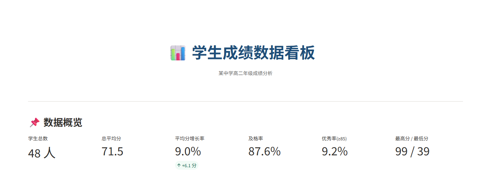
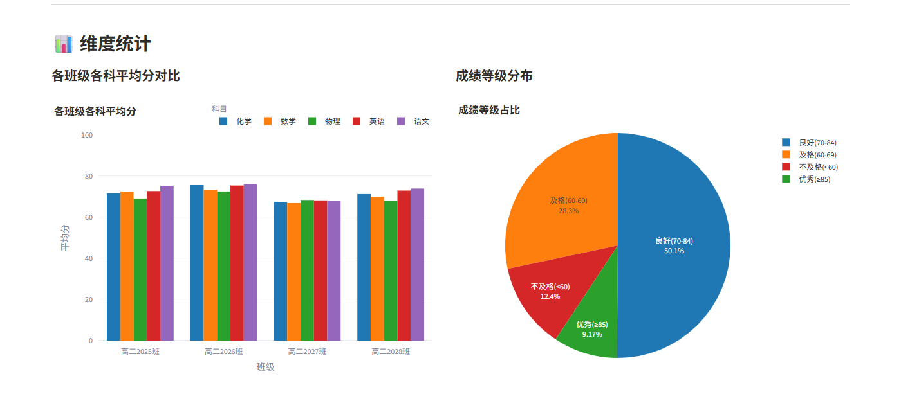
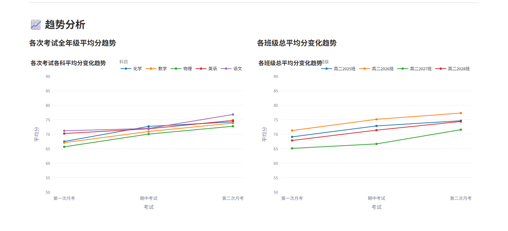
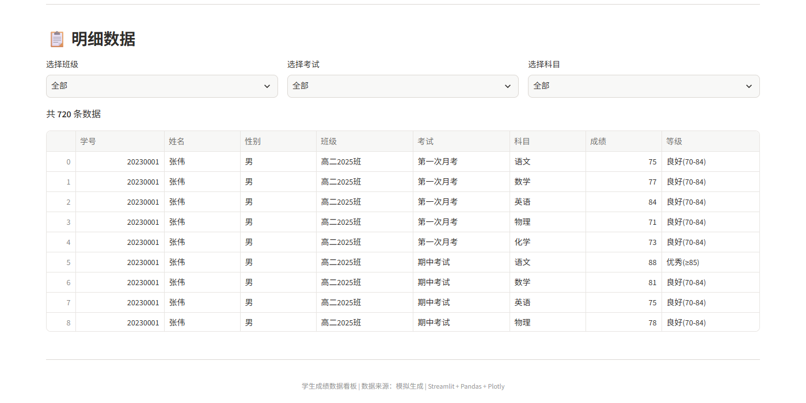

# 实验2：学生成绩数据看板的设计与实现

《Python 程序设计》实验2。用 Streamlit + Pandas + Plotly，把一份模拟的中学高二成绩数据（4 个班、48 名学生、3 次考试、5 门科目，共 720 条记录）做成一个可交互的数据看板。

## 看板效果






## 功能模块

| 模块 | 内容 |
|---|---|
| 数据概览 | 6 张指标卡：学生总数、总平均分、平均分增长率、及格率、优秀率、最高/最低分 |
| 维度统计 | 各班级各科平均分分组柱状图；成绩等级分布饼图 |
| 趋势分析 | 三次考试各科平均分折线；各班平均分折线 |
| 明细数据 | 按班级 / 考试 / 科目筛选后查看原始成绩表 |

## 运行

```bash
pip install -r requirements.txt
streamlit run dashboard.py
```

浏览器访问 http://localhost:8501 。

重新生成模拟数据（可选，随机种子固定，结果不变）：

```bash
python generate_data.py
```

## 文件说明

| 文件 | 说明 |
|---|---|
| `dashboard.py` | 看板主程序 |
| `generate_data.py` | 模拟成绩数据生成脚本 |
| `student_scores.csv` | 720 条成绩数据 |
| `take_screenshots.py` | 自动截图脚本（需 `pip install playwright`，使用本机 Edge，无需下载浏览器内核） |
| `screenshots/` | 看板成品截图 |
| `实验报告/` | 实验报告（md 与 docx 双版本）；`实验2 数据看板的设计与实现.docx` 为老师下发的任务书原件 |

## 数据说明

数据为程序模拟生成，不涉及真实学生信息。字段：学号、姓名、性别、班级、考试、科目、成绩；每名学生基础能力服从 N(72,10)，叠加考试整体偏移、科目偏差与随机波动后裁剪到 15～100。

## 实验报告

- [实验2 数据看板 实验报告（Markdown）](实验报告/实验2%20数据看板%20实验报告.md)
- [实验2 数据看板 实验报告（Word）](实验报告/软件工程23-1李伟鑫3232052051109%20实验2%20数据看板%20实验报告.docx)