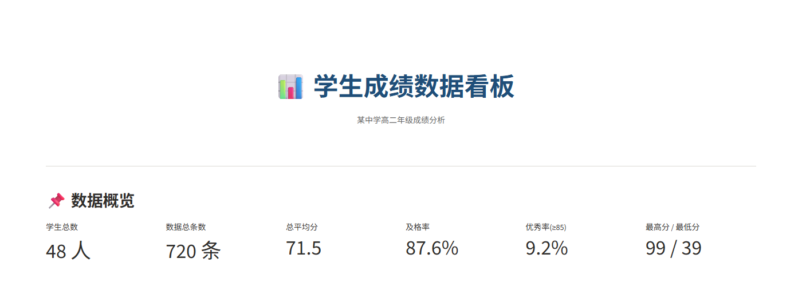
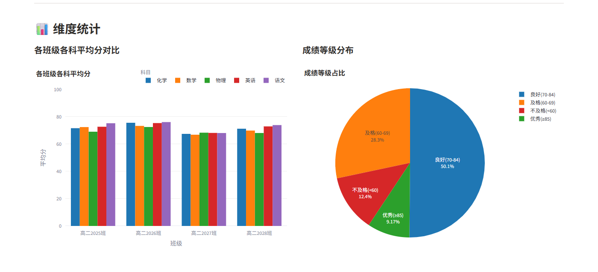
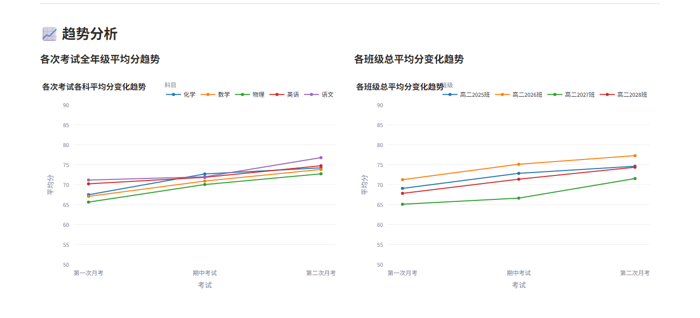
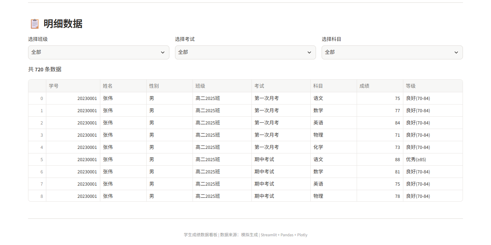
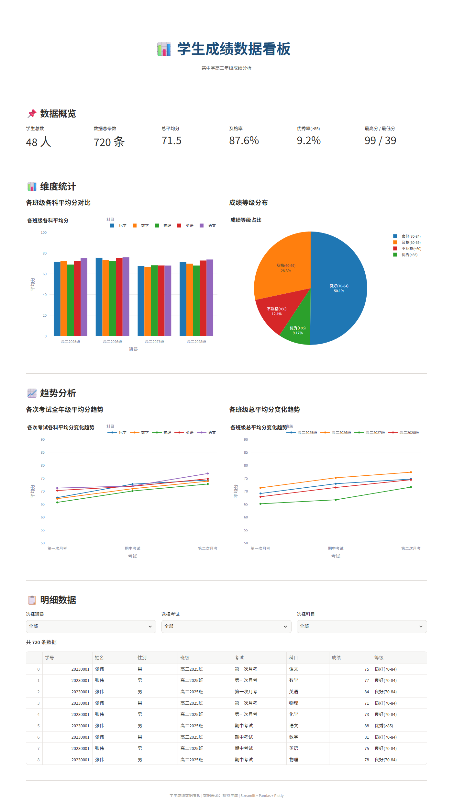

# 实验2 数据看板的设计与实现

- 姓名：李伟鑫
- 学号：3232052051109
- 班级：软件工程2023-1班
- 实验日期：2026 年 11 月

## 一、实验环境

- 硬件：个人计算机（Windows）
- 软件：PyCharm、Python 3.12
- 技术栈：Streamlit 1.67.0、Pandas 3.1.1、Plotly 7.1.0

## 二、任务1：看板需求分析与版面设计

**业务场景**：某中学高二年级成绩分析。

**数据规模**：4 个班级（高二2025班～高二2028班）× 48 名学生 × 3 次考试 × 5 门科目，共 720 条成绩记录。

**核心需求**分四层：

1. 整体水平：学生人数、总平均分、及格率、优秀率、最高/最低分；
2. 分类对比：各班级各科目平均分差异、成绩等级分布；
3. 时间趋势：三次考试各科平均分走势、各班平均分走势；
4. 明细查看：按班级 / 考试 / 科目筛选后查看原始记录。

**版面设计**：页面自上而下划分四个区域，宽度铺满屏幕：

- 数据概览区：6 张指标卡横向排列；
- 维度统计区：柱状图、饼图左右并排；
- 趋势分析区：两张折线图左右并排；
- 明细数据区：3 个筛选框 + 数据表格。

**配色方案**：标题主色 `#1f4e79`；图表使用 5 种对比色区分科目和班级；成绩等级用绿（优秀）、蓝（良好）、橙（及格）、红（不及格）四级递进。

## 三、任务2：实验数据准备与预处理

**字段**：学号、姓名、性别、班级、考试、科目、成绩。

**生成规则**（`generate_data.py`）：

- 每班 12 人，共 48 名学生，学号从 20230001 起连续编号；
- 每名学生设定基础能力值，服从 N(72, 10)；
- 每次考试叠加整体偏移（第一次月考 -3、期中 0、第二次月考 +4），体现成绩随复习推进的变化；
- 每门科目叠加固定偏差（语文 +2、数学 -1、英语 +1、物理 -2、化学 0）；
- 每科成绩再叠加 N(0, 6) 的随机波动，四舍五入后裁剪到 15～100；
- 随机种子固定为 42，保证数据可复现。

**预处理与校验**：

- 保存为 CSV（utf-8-sig 编码，Excel 直接打开中文不乱码）；
- 检查无空值；成绩全部落在 15～100 内，无需剔除异常值；
- 同一学生的学号、姓名、性别、班级保持一致，考试与科目取值固定，可直接用于分组统计。

**统计维度**：

- 时间维度：考试（3 次）；
- 分类维度：班级（4 个）、科目（5 门）、性别；
- 数值维度：成绩。

## 四、任务3：基础可视化图表搭建

共实现 4 类图表：

| 图表 | 位置 | 展示内容 |
|---|---|---|
| 指标卡（st.metric） | 数据概览 | 学生总数、数据条数、总平均分、及格率、优秀率、最高/最低分 |
| 分组柱状图（px.bar） | 维度统计 | 各班级 × 各科目平均分 |
| 饼图（px.pie） | 维度统计 | 优秀 / 良好 / 及格 / 不及格四级人数占比 |
| 折线图（px.line） | 趋势分析 | 三次考试各科平均分走势；三次考试各班平均分走势 |
| 数据表（st.dataframe） | 明细数据 | 筛选后的原始成绩记录 |

## 五、任务4：静态数据看板整合实现

- 通过 `st.set_page_config` 设置页面标题、图标和宽屏布局；
- 各区域用分隔线 + 小标题划分层级；
- 使用 `st.columns` 左右分栏，柱状图与饼图、两张折线图并排展示；
- 所有图表统一透明背景、12 号字体、顶部横向图例、固定纵轴范围（0～100 / 50～90），保证横向对比时视觉一致；
- 底部增加统一的页脚说明。

## 六、任务5：实验结果验证与总结

### 1. 数据准确性核对

看板计算得到的核心指标：

- 学生总数 48 人，数据 720 条（48 × 3 × 5，与生成规则一致）；
- 总平均分 71.5；
- 及格率 87.6%（631/720）；优秀率 9.2%（66/720）；
- 最高分 99，最低分 39；
- 等级分布：良好 50.1%、及格 28.3%、不及格 12.4%、优秀 9.2%，四项合计 100%。

用明细表随机抽查记录，与卡片、图表数值一致。

### 2. 交互功能验证

明细数据区提供班级、考试、科目三个筛选框，选择后表格行数与"共 N 条数据"提示同步更新，图表数据不受影响，与设计预期一致。

### 3. 遇到的问题及解决方法

| 问题 | 原因 | 解决方法 |
|---|---|---|
| 自动截图 5 张中有 4 张完全相同 | 新版 Streamlit 的滚动发生在页面内部容器，`window.scrollTo` 不起作用 | 把浏览器视口高度调到整页高度，再按四个模块标题的坐标裁剪截图 |
| 控制台提示 `use_container_width` 已弃用 | 新版本改用 `width` 参数 | 当前版本仍兼容、显示正常，记录为后续升级项 |
| Excel 打开 CSV 中文乱码 | 纯 UTF-8 无 BOM | 保存时使用 utf-8-sig 编码 |

### 4. 总结

完成必做任务 1～5：从数据生成、预处理到 4 类图表、四大模块整合，最终得到一份可直接运行的静态数据看板。通过本次实验理解了"指标卡 → 对比 → 趋势 → 明细"的看板信息层级，以及 Streamlit 的列布局与图表联排方式。进阶、扩展任务本次未实现。

## 附：成品截图

